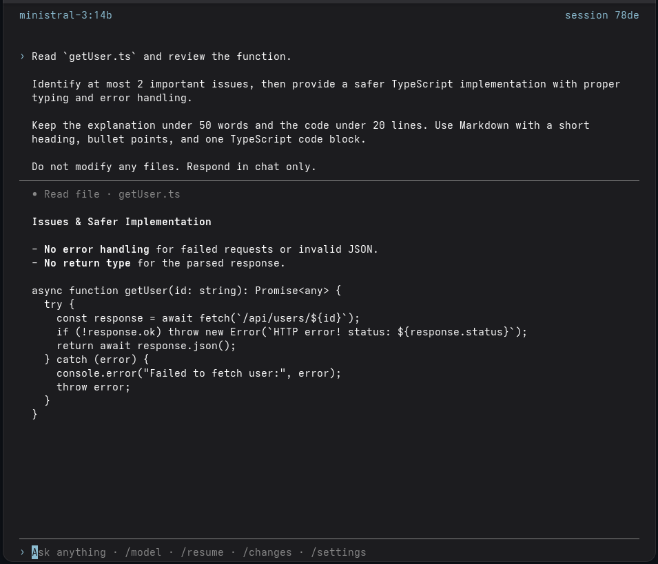

# Codesh

Codesh is a terminal coding agent powered by local models through Ollama. Chat with a model,
inspect your workspace, and approve file changes or process execution from an OpenTUI interface.

<!-- After adding docs/assets/codesh.png, replace this comment with:  -->

## Features

- Streaming responses and Markdown rendering in an OpenTUI terminal UI.
- Workspace file discovery, text search, reading, creation, editing, moving, and deletion.
- Interactive approval before file changes and foreground process execution.
- Persistent sessions with conversation history and resume.
- Model switching and persistent application settings.
- Read-only Git status and diff review through `/changes`.
- Bounded conversation context, best-effort session memory, and optional history retrieval.

## Getting Started

You need Bun to install dependencies and build, an interactive terminal, and a running Ollama
server with an installed chat model. Agent actions require native tool calls; reliability varies
by model. Git on `PATH` with `--no-lazy-fetch` support is required for `/changes`.

From the root of a fresh clone of this repository, install dependencies and build:

```sh
bun ci --os '*' --cpu x64
bun run build
```

The install flags include native dependencies for both build targets:

- **Linux x64 (glibc):** `dist/codesh` and `dist/rg`.
- **Windows x64:** `dist/codesh.exe` and `dist/rg.exe`.

Keep the matching executable pair together. Compiled executables run without Bun or a project
checkout. Add the absolute path to `dist` to your shell's `PATH`, then launch from your workspace:

```sh
codesh
```

The current directory becomes the workspace. Choose an installed model with `/model` before
chatting if none is selected.

## Usage

Launch modes:

```sh
codesh           # Start a new session
codesh resume    # Open the session picker to resume a saved session
codesh --resume  # Equivalent to codesh resume
```

Slash commands inside chat:

- `/model [name]` — choose an installed Ollama model or switch directly by name.
- `/resume` — resume a previous session or start a new one.
- `/changes` — review staged and unstaged Git changes while chat is idle.
- `/settings` — inspect and edit persistent preferences.

Essential shortcuts:

- **Enter:** send a prompt. **Shift+Enter** or **Ctrl+J:** insert a newline.
- **F2 / F3:** open the model / session picker.
- **Esc:** cancel an active response or close a dialog.
- **Ctrl+C:** cancel an active response; exit when idle or at an approval prompt.
- **PageUp / PageDown:** scroll history. **Ctrl+Home / Ctrl+End:** jump to its ends.
- At an approval prompt, **y** allows the action; **n** or **Esc** denies it.

To copy text, hold Shift while selecting it with your mouse, then press Ctrl+Shift+C (or your
terminal's copy shortcut).

Sessions are stored locally in `.agent/sessions/<session-id>/events.jsonl` inside each workspace.

## Configuration

Use `/settings` to configure the Ollama server URL, default model, keep-alive duration, context
window, and output token limit. The default server is `http://localhost:11434`; restart Codesh
after changing its URL.

Saved preferences are shared across workspaces:

- **Linux:** `$XDG_CONFIG_HOME/codesh/settings.json`, defaulting to
  `~/.config/codesh/settings.json`.
- **Windows:** `%APPDATA%\codesh\settings.json`, falling back to the user's
  `AppData\Roaming\codesh\settings.json`.

## Development

With dependencies installed, run from the repository root:

```sh
bun run start         # Run from source
bun run check         # Formatting, types, and tests
```

Use `bun run build:linux` or `bun run build:windows` to build a single target. See
[docs/ARCHITECTURE.md](docs/ARCHITECTURE.md) for technical details.

## License

[MIT](LICENSE).
